<div align="center">

# ⚡ Life OS

### Aplikacija, ki me prepriča, da začnem, in mi pokaže, da napredujem.

**Kar koli pošljem s telefona, konča na pravem mestu. Doma, na mojem strežniku, brez oblaka.**


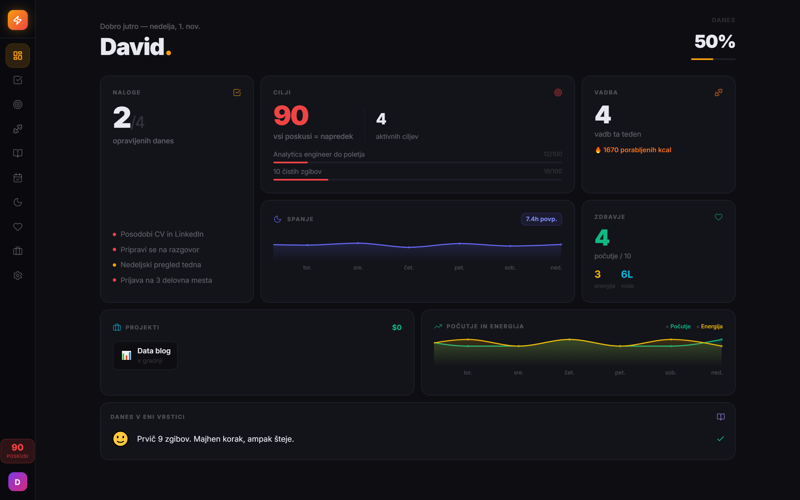

<sub>Na vseh posnetkih so izmišljeni demo podatki (<code>aplikacija/demo/demo-podatki.js</code>), ne moji pravi.</sub>

</div>

---

> **Kako brati.** Ta README je zgodba v šestih poglavjih: zakaj projekt obstaja, kako en sam glasovni posnetek potuje skozi sistem, kaj že deluje, kaj gradim naprej, zakaj sem izbral ravno te kocke in kaj sem se naučil. Kdor hoče kroniko po fazah, s slepimi ulicami in strojno opremo, ki je med delom odpovedala, jo najde v **[ZGODBA.md](ZGODBA.md)**.

1. [Zakaj: osemnajst sistemov in noben v uporabi](#1-zakaj-osemnajst-sistemov-in-noben-v-uporabi)
2. [Pot enega posnetka](#2-pot-enega-posnetka)
3. [Kaj že deluje](#3-kaj-že-deluje)
4. [Kaj gradim naprej](#4-kaj-gradim-naprej)
5. [Zakaj ravno to](#5-zakaj-ravno-to)
6. [Kaj sem se naučil](#6-kaj-sem-se-naučil)

---

## 1. Zakaj: osemnajst sistemov in noben v uporabi

Poznam se. Ko imam rok in posledico, naredim. Ko ju nimam, gradim sisteme in jih potem ne uporabljam. V nekem trenutku sem imel osemnajst vzporednih sistemov za produktivnost, zapiske v desetih aplikacijah in dva različna »jaza«: enega na telefonu in enega na računalniku, ker je vsak brskalnik hranil svoje podatke. Dnevnik z navodilom »napiši, kako je bil dan« je bil 46 dni prazen. **Life OS rešuje ravno to.** Vse, kar mi pride na misel ali v nabiralnik, gre skozi en sam vhod. Od mene zahteva največ eno vrstico ali en klik. Vsako nedeljo mi pokaže, ali sem boljši kot prejšnji teden. In vse to teče doma, na starem prenosniku, ki ga z interneta ni videti. Aplikacija ne meri, ali sem popoln. Meri, ali sem se pojavil.

| Kar me ustavi | Kaj naredi Life OS |
|---|---|
| Previsok prag za začetek | **Ena vrstica na dan.** Dnevnik, ki ga izpolnim v desetih sekundah. Posnetek, ki ga samo izgovorim. |
| Neuspeh me ustavi | **»Do uspeha skozi neuspehe.«** Vsak neuspel poskus se šteje. Sto poskusov je dosežen cilj. |
| Ne vem, ali napredujem | **Tedenski pregled:** ta teden proti prejšnjemu in poročilo, ki ga napiše lokalni AI. |
| Pozabim | **Opomniki na telefon** ob 16.00 (zapadle naloge), ob 19.00 (cilji) in uro pred dogodkom. Po 21. uri nikoli. |
| Vse je razmetano | Naloge, cilji, dnevnik, zdravje, finance, koledar, mail in posnetki **na enem mestu**, na vseh napravah. |

---

## 2. Pot enega posnetka

Sobota, 8. novembra 2026, 10.14. Stojim v kuhinji in rečem v telefon: **»V taske: moram kupiti mleko.«** Posnetek delim na poštni predal Life OS in telefon pospravim. Kar se zgodi v naslednjih 45 minutah, je celotna arhitektura tega projekta.

1. **10.20 · strežnik doma.** Bralec maila, ki teče vsakih 15 minut, vidi nov mail. Priponko shrani, mail označi kot prebran in mu da oznako »Obdelano«. Original ostane v Gmailu. Strežnik ničesar ne obdeluje. Samo prejme, hrani in čaka.
2. **10.30 · namizni računalnik.** Opravilo *prevzem* (vsakih 15 minut, kadar je računalnik prižgan) potegne posnetek prek SSH, preveri njegov prstni odtis (sha256) in ga vloži v shrambo, v mapo `zvok/2026-11/`. Obstoječe datoteke nikoli ne prepiše. Nato zažene prepis.
3. **10.31 · prepis.** Whisper (model large-v3-turbo z mojim slovarjem) na grafični kartici posnetek prepiše v nekaj sekundah (na preizkusu 8 sekund posnetka v 2,6 sekunde). Tokrat sliši *»V taz«* namesto *»V taske«*. Pravilo, ki iz prve besede ugotovi, kam zapis spada, tega ne pozna. Posnetek gre med »Nerazvrščeno«.
4. **10.40 · obvestilo.** *Čakalnica* na strežniku opazi spremembo in pošlje na telefon: **»Ne vem, kam spada«**, z gumbi *Naloga · Dnevnik · Ideja · Zavrzi*. Obvestila pridejo samo, ko se kaj spremeni, in samo med 7. in 21. uro.
5. **10.59 · jaz.** Tapnem *Naloga*. Strežnik zapiše nalogo, aplikacija jo pokaže na iPhonu in računalniku, telefon dobi »Zapisano med naloge«.
6. **11.40 · kopija.** Vsako uro se cela mapa LifeOS kopira na drugi disk. Shramba se tam samo dopolnjuje in nikoli prepiše, zato pokvarjen original ne more uničiti dobre kopije.

Pravilo za »V taz« sem popravil še isti dan. Naslednji posnetek gre skozi brez vprašanja. Tako sistem raste: ne z novo funkcijo, ampak s popravkom pravila vsakič, ko ga ujamem pri napaki.

### Isti tok na enem diagramu

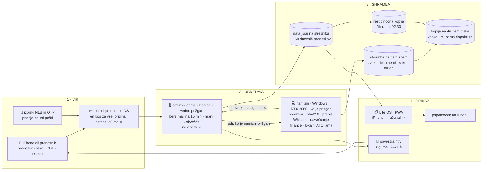

### Ta graf se je začel v zvezku

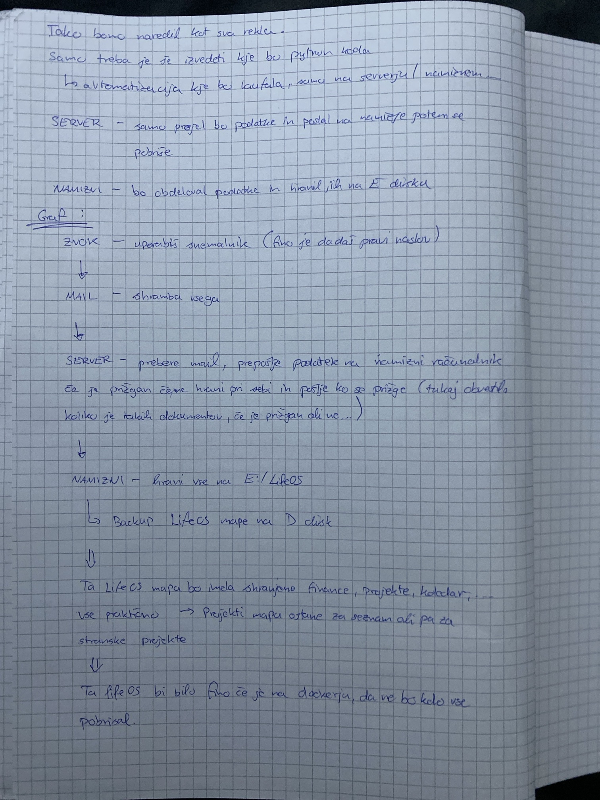

Novembra sem pri »enem košu za vse vhode« padel v past: vse sem prepustil AI asistentu. V eni seji je naredil preizkus štirih modelov za prepis govora in dva načrta arhitekture ter ju združil, še preden sem razumel, kaj se dogaja. Imel sem kup datotek in nisem več vedel, kje smo.

Ustavil sem se, vzel zvezek in narisal, kaj naj kam teče: **strežnik samo prejme in prepošlje, namizni obdela in hrani.** Iz skice je nastal [`graf/graf-za-ai.md`](graf/graf-za-ai.md), ki je zdaj *edini vir resnice* za tok podatkov. Vsako vozlišče ima stanje: *potrjeno* (sem rekel), *odprto* (še nisem odločil) ali *deluje* (preverjeno v praksi). AI graf upošteva, ne obratno. Nova vozlišča sme le predlagati v razdelku »Odprta vprašanja«. V enem dnevu je graf šel skozi pet različic, vsaka po enem potrjenem koraku. Različica za ljudi: [`graf/graf-za-ljudi.html`](graf/graf-za-ljudi.html).

<br clear="all">

### Kje kaj teče

Vsa koda je v enem gitu. Teče pa na dveh mestih: na strežniku, ki je vedno prižgan, in na namiznem, ki ima grafično kartico in velik disk. Na telefonu ne teče nič. Telefon samo pošilja in gleda.

| | Program | Kdaj | Kaj dela |
|---|---|---|---|
| 🖥️ **strežnik** | aplikacija (`streznik.py`) | vedno | API in aplikacija; en JSON z verzijami, dnevni posnetki 60 dni |
| | bralec maila | vsakih 15 min | shrani mail in priponke, označi »Obdelano«, prepozna izpiske in razgovore |
| | čakalnica | vsakih 15 min | šteje, kaj čaka na namizni, in pošlje obvestilo samo ob spremembi |
| | izpiski, naročnine | po vsakem branju maila | PDF izpiskov NLB in OTP → transakcije; naročnine z opomnikom dan prej |
| | opomniki | 16.00 · 19.00 · uro pred dogodkom · ned 19.30 | zapadle naloge, cilji, dogodki, tedensko poročilo |
| | čiščenje | 04.00 | po 7 dneh počisti, kar je varno v shrambi **in** na drugem disku; zaenkrat samo izpiše |
| | nočna kopija (restic) | 02.30 | šifrirana kopija strežnika; namizni jo zjutraj potegne k sebi |
| 💻 **namizni** | prevzem | vsakih 15 min | potegne nove datoteke, preveri sha256, besedilo razvrsti po prvi besedi |
| | prepis (Whisper) | ob novem posnetku | posnetek → besedilo → naloga / dnevnik / ideja / nerazvrščeno |
| | kopija na drugi disk | vsako uro | shrambo samo dopolnjuje, vsak original preveri |
| | lokalni AI (Ollama) | vsako minuto | odgovori na vprašanja iz aplikacije, dnevni povzetek po 20. uri, tedensko poročilo |
| | finance | 17.00 | izpiski in IBKR → preglednica → povzetek v aplikacijo |

### Najzanimivejši del kode: sinhronizacija brez baze

Vsaka sprememba v aplikaciji je **funkcija** (`podatki → novi podatki`), ki gre v čakalno vrsto. Ko jo pošljem strežniku, povem, katero verzijo sem nazadnje videl. Če je vmes shranila druga naprava, strežnik vrne `409` in svojo različico. Aplikacija nato **ponovi moje spremembe na vrhu novih podatkov**. Telefon in računalnik nikoli ne prepišeta drug drugega, brez baze in brez knjižnic. → [`aplikacija/src/store/useStore.ts`](aplikacija/src/store/useStore.ts), [`streznik/streznik.py`](streznik/streznik.py)

---

## 3. Kaj že deluje

Vse spodaj teče na mojem strežniku in uporabljam vsak dan. Prva stran je »Danes«: odstotek dneva, tri prioritete, cilji s poskusi, spanje, počutje in dnevnik v eni vrstici.

<table>
<tr>
<td width="50%">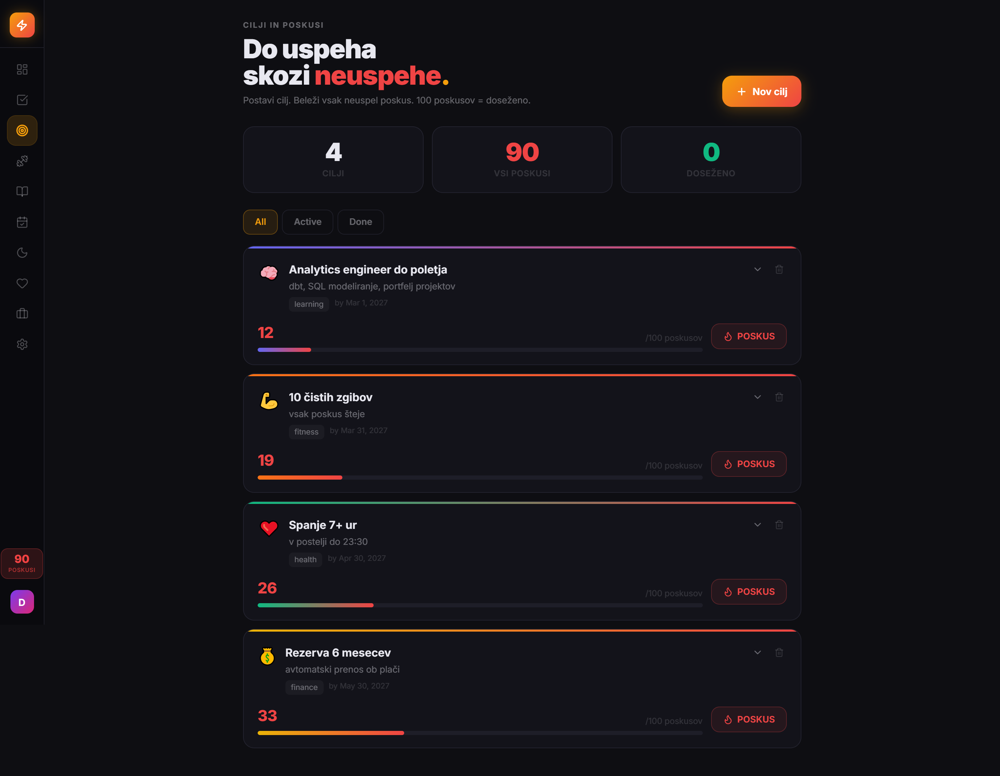<br><b>Cilji in poskusi.</b> Vsak neuspel poskus je korak naprej. Sto poskusov je dosežen cilj.</td>
<td width="50%">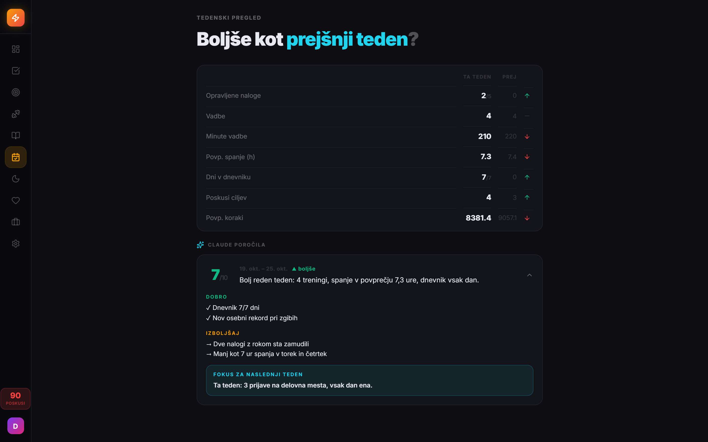<br><b>Tedenski pregled.</b> Ta teden proti prejšnjemu in poročilo z enim fokusom za naslednji teden. Na posnetku s 1. 11. ga še piše Claude; od 4. 11. ga piše lokalni model na mojem računalniku.</td>
</tr>
<tr>
<td>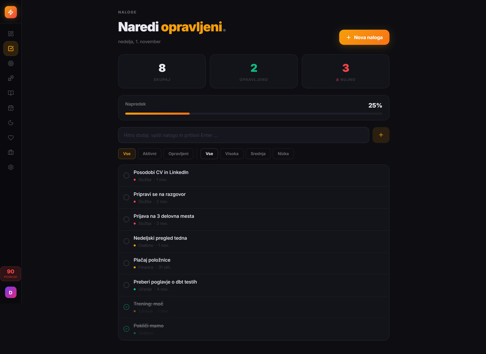<br><b>Naloge</b> s prioriteto in rokom. Zapadle pridejo na telefon ob 16.00.</td>
<td>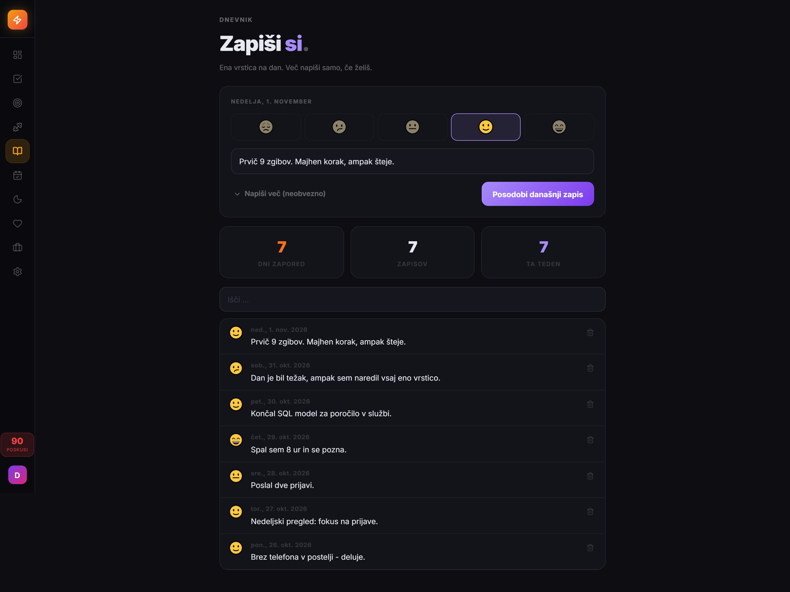<br><b>Dnevnik.</b> Ena vrstica na dan in razpoloženje. Deset sekund.</td>
</tr>
<tr>
<td>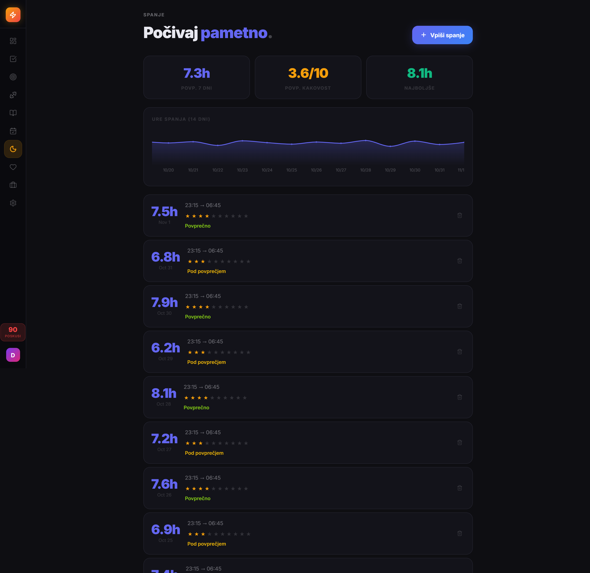<br><b>Spanje.</b> Ure, kakovost, trend.</td>
<td>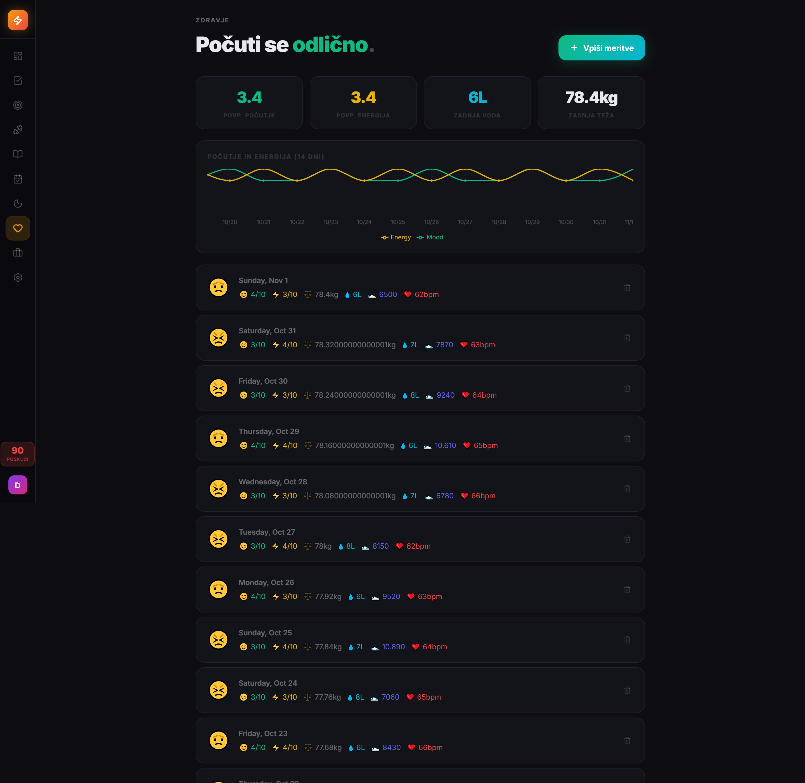<br><b>Zdravje.</b> Teža, voda, koraki, počutje in energija.</td>
</tr>
<tr>
<td>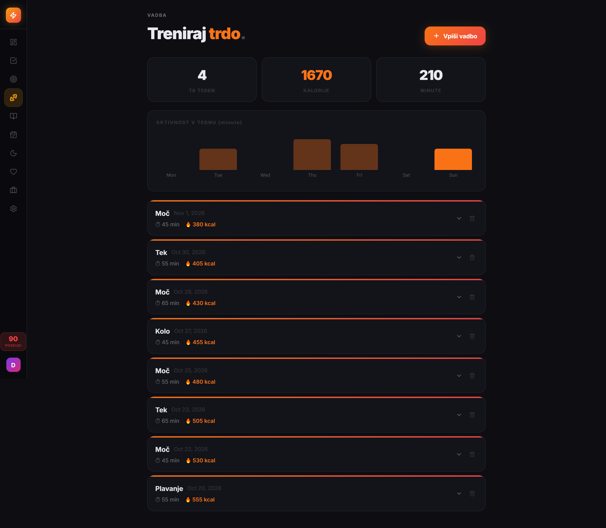<br><b>Vadba.</b> Treningi, vaje, kalorije.</td>
<td align="center">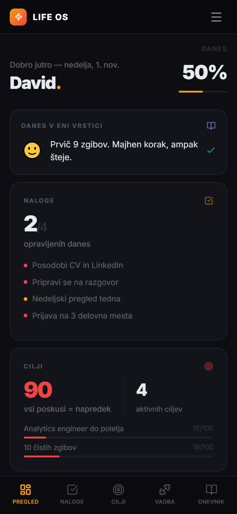<br><b>Na telefonu.</b> Namestljiva aplikacija (PWA), isti podatki kot na računalniku.</td>
</tr>
</table>

**Preverjeno od konca do konca** (datum pove, kdaj sem to zares videl delovati):

| Kdaj | Kaj |
|---|---|
| 31. 10. | obnova iz nočne kopije strežnika; kopija, ki je nisi obnovil, ni kopija |
| 4. 11. | iPhone vedno dobi novo verzijo aplikacije; bralec maila; izpiski NLB in OTP iz maila → transakcije → stran Finance; stran Omrežje (kabel, usmerjevalnik, internet) |
| 7. 11. 20.44–20.51 | posnetek, slika in PDF v enem mailu → shramba (sha256 ujema) → obvestilo »Shranjeno na namizni: 1 dokument, 1 slika, 1 posnetek« → kopija na drugi disk (10/10 preverjeno) |
| 8. 11. | posnetek → prepis → odločitev z gumbom → naloga (zgodba iz 2. poglavja) |
| vsak dan | kopija na drugi disk vsako uro, vsak original preverjen; obvestila samo med 7. in 21. uro |

**Kar na posnetkih še ni** (dodano novembra, koda pride v repo v naslednjem koraku): Finance (izpiski, naročnine, pregled po letih, plan za mesec), Koledar (tudi Applov naročeni koledar), Stranke, Služba (razgovori iz službenega maila, v koledar z enim klikom), Borza, Vprašaj AI (lokalni model, ocena 👍/👎 pod vsakim odgovorom), Omrežje.

**Še ni preverjeno** (zgrajeno, čaka prvi samodejni tek ali mojo odločitev):
- nedeljsko tedensko poročilo lokalnega AI: prvi samodejni nedeljski tek še ni potrjen,
- mesečno poročilo portfelja (prvič 1. 12.) in tedenska analiza sektorjev,
- čiščenje strežnika po 7 dneh: teče v suhem načinu, zares ga vklopim jaz,
- prepis: enkrat preverjen od konca do konca, slovar raste z uporabo.

---

## 4. Kaj gradim naprej

Vrstni red določam jaz, en korak naenkrat. Vsak korak dobi eno vrstico v `PROGRESS.md`, vsaka odločitev eno v `DECISIONS.md`.

| Kaj | Stanje | Pogoj |
|---|---|---|
| **Vklop čiščenja na strežniku** po 7 dneh, samo za datoteke, ki so v shrambi in na drugem disku | nameščeno, suhi način | ko izpis nekaj dni kaže pravo (okoli 14. 11.) |
| **Objava kode vhodov v ta repo**: bralec maila, čakalnica, prevzem, prepis, novi `streznik.py` | deluje v živo; repo ima stanje s 1. 11. | ko jo očistim skrivnosti |
| **Kaj od obdelave še ostane na strežniku** (izpiski, naročnine in opomniki so nastali pred grafom) | odprto vprašanje v grafu | moja odločitev |
| **Docker za Life OS**, da ga nihče pomotoma ne pobriše | odprto | |
| **Apple Zdravje → spanje in koraki** prek Bližnjice na iPhonu | odprto | |
| **Testi za sinhronizacijo** (409 in ponovitev sprememb) | odprto | |
| **Tedenski pregled ocen 👎** lokalnega AI, da se njegova navodila popravljajo | ročno | |
| **Baterija strežnika** kaže 0 %; ob izpadu elektrike strežnik ugasne | odprto | diagnostika ali nova baterija |

---

## 5. Zakaj ravno to

Vsaka izbira ima ceno. Tu je, kaj sem dobil in kaj plačujem.

| Odločitev | Zakaj | Kaj me stane |
|---|---|---|
| **Star prenosnik kot strežnik** (HP, i7 z dvema jedroma, 7,7 GB RAM, Debian 13) | brezplačen, tih, vedno prižgan; Linux se učim na pravi železnini | šibek, zato obdelava na namiznem; baterija ne drži |
| **Tailscale namesto odprtih vrat** | strežnik z interneta ni viden; SSH samo s ključem; ocena Lynis 62 → 75 | brez Tailscale na napravi ni dostopa; lasten poštni strežnik bi rabil odprta vrata, zato ločen Gmail predal |
| **Python brez knjižnic, en JSON namesto baze** | en uporabnik, malo podatkov; nič odvisnosti, ki zastarijo | vse v pomnilniku; konflikte rešujem sam (409 in ponovitev) |
| **React 19, TypeScript, Vite, Tailwind kot PWA** | ena koda za telefon in računalnik; namestitev brez App Store; lasten service worker | brez povezave dela le, kar je bilo že odprto |
| **Mail kot vhodni koš** | iPhone ga že ima (Deli → Mail); original ostane v Gmailu; brez lastne aplikacije za nalaganje | zamik do 15 minut; aplikacija mail samo bere, nikoli ne pošilja |
| **Strežnik samo prejme in prepošlje, namizni obdela** | grafična kartica in disk sta na namiznem; strežnik ostane preprost | ko je namizni ugasnjen, stvari čakajo; zato obvestilo »čaka« |
| **Whisper lokalno** (large-v3-turbo z slovarjem, RTX 3060) | zasebnost; brez plačljivih API-jev; slovenščina z mojimi besedami | model 1,5 GB; »V taske« ni »V taz«, slovar raste ročno |
| **Lokalni AI** (Ollama, qwen3.5:9b) | podatki ostanejo doma; dejstva izračuna Python, model jih le ubesedi | slabši od oblačnih modelov; zato samo povzetki in vprašanja o mojih podatkih |
| **ntfy v Dockerju** | obvestila z gumbi brez Applovega računa za obvestila; ista pot za SSH prijave in nove naprave v omrežju | še en servis za vzdrževanje |
| **restic ponoči in kopija na drugi disk vsako uro** | šifrirano; obnova preizkušena; shramba se samo dopolnjuje | dva mehanizma kopij |
| **Git samo za kodo, podatki zunaj** | repo lahko objavim; osebne podatke varuje kopija, ne git | brez zgodovine podatkov v gitu |
| **AI piše programe, ne vodi traku** | enak vhod → enak izhod; vsak korak razumem; AI se v dolgi verigi zacikla | počasneje kot »AI naredi vse« |

---

## 6. Kaj sem se naučil

- **Načrtovati od konca do konca**: vir → obdelava → shramba → prikaz → kopija → obvestilo. Najprej na papir, šele nato v kodo.
- **Podatki brez izgube**: verzije, konflikti, prstni odtisi, dnevni posnetki in obnova, ki sem jo zares preizkusil.
- **Varnost kot privzeto**: nič odprtih vrat, SSH samo s ključem, skrivnosti nikoli v kodi.
- **Produkt za uporabnika**, tudi če sem to jaz: funkcija, ki je ne uporabljam, nima vrednosti. Zato nizek prag in opomnik ob pravem času.
- **Vedeti, kdaj nehati**: stenska tablica iz leta 2012 je bila odlična vaja iz diagnoze (pokvarjen sistemski XML, odpoved NAND pomnilnika), cilj pa je bil planer, ne tablica. Koda je ostala v [`tablica/`](tablica).
- **Delo z AI brez izgube nadzora**: 80 % razmisleka in odločitev je mojih, 20 % je AI. Najprej mi našteje korake, nato narediva samo trenutnega. Nič naprej brez mojega »da«. Vsak projekt ima tri datoteke, `CLAUDE.md` (zemljevid), `PROGRESS.md` (stanje) in `DECISIONS.md` (odločitve), da človek in AI vedno vesta, kje smo.

Projekt gradim v paru s **Claude Code**. Jaz postavljam cilje, odločam, preverjam na telefonu in rišem grafe. AI piše kodo po mojih korakih, bere dnevnike in piše zapiske. To je način dela, ki ga želim prinesti tudi v ekipo.

---

## Repozitorij

| Mapa | Kaj je | Stanje |
|---|---|---|
| [`aplikacija/`](aplikacija) | spletna aplikacija (React 19, TypeScript, Vite, Tailwind, Recharts, PWA); slovenščina in angleščina | stanje s 1. 11.: pregled, naloge, cilji, vadba, dnevnik, teden, spanje, zdravje, projekti |
| [`streznik/`](streznik) | `streznik.py` (API, verzije, 409), opomniki, tedensko poročilo, systemd enote | stanje s 1. 11.; bralec maila, čakalnica in vnosi iz maila pridejo |
| [`infrastruktura/`](infrastruktura) | nftables, SSH, fail2ban, samodejne posodobitve, ntfy, restic, obvestila ob prijavi in novi napravi | aktualno |
| [`graf/`](graf) | tok podatkov: `graf-za-ai.md` (vir resnice, različica 5), `graf-za-ljudi.html`, skica iz zvezka | aktualno |
| [`tablica/`](tablica) | Android kiosk (Java, brez Gradla) in planer v Pythonu, ki riše neposredno na zaslon | zaključeno; tablica zavržena 31. 10. |
| [`slike/`](slike) | posnetki zaslona z demo podatki | 1. 11. |
| [`ZGODBA.md`](ZGODBA.md) | kronika po fazah: načrt, strežnik, aplikacija, navade, tablica, past AI-ja | |

### Zagon

```bash
cd aplikacija
npm install
npm run dev
```

Aplikacija deluje tudi brez strežnika (podatki ostanejo v brskalniku). Za demo podatke odpri konzolo brskalnika, prilepi vsebino [`aplikacija/demo/demo-podatki.js`](aplikacija/demo/demo-podatki.js) in osveži stran.

Strežnik: `python3 streznik/streznik.py`, nato `LIFEOS_API=http://127.0.0.1:8090 npm run dev`.

### Kaj namenoma ni v repozitoriju

Gesla, ključi (SSH, podpisni ključ za Android), naslov mojega Tailscale omrežja, ime teme za obvestila, naslov poštnega predala, domači IP-ji, moji podatki, posnetki in prepisi. Kjer jih koda potrebuje, so zamenjani z nadomestki (`TVOJ-TAILNET`, `$KS_GESLO`, `$NTFY_TEMA`).

---

<div align="center">

**David Planinšek** · junior data engineer → analytics engineering

</div>
