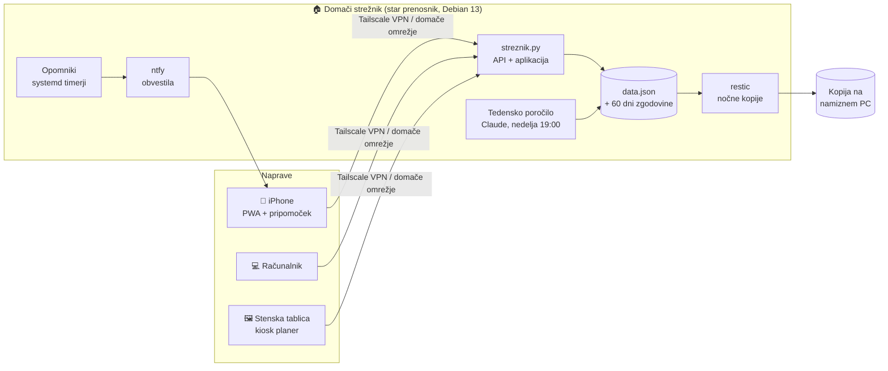

<div align="center">

# ⚡ Life OS

### Aplikacija, ki me prepriča, da začnem — in mi pokaže, da napredujem.

**Moj dan, moji cilji in vsi zapiski na enem mestu. Na lastnem strežniku, doma.**


</div>

---

## 🎯 Zakaj sem to naredil

Poznam se: **ko imam rok in posledico, naredim. Ko ju nimam, gradim sisteme in jih ne uporabljam.**
Imel sem zapiske v desetih aplikacijah, cilje v glavi in občutek, da stojim na mestu.

Life OS je moj odgovor na to. Ni še ena aplikacija za opravila — je **orodje, s katerim samega sebe prepričam v delo**:

| Problem | Kako ga Life OS reši |
|---|---|
| Previsok prag za začetek → nič ne naredim | **Ena vrstica na dan** je dovolj. Dnevnik, ki ga izpolniš v 10 sekundah. |
| Neuspeh me ustavi | **»Do uspeha skozi neuspehe«** — vsak neuspel poskus se *šteje* kot napredek. 100 poskusov = cilj dosežen. |
| Ne vem, ali sem boljši kot prej | **Tedenski pregled**: ta teden proti prejšnjemu + poročilo, ki ga vsako nedeljo napiše AI. |
| Pozabim | **Opomniki na telefon** ob 16:00 (zapadle naloge) in 21:30 (večerni pregled). |
| Zapiski so razmetani | Naloge, cilji, vadba, spanje, zdravje, projekti in dnevnik — **vse na enem mestu**, na vseh napravah. |

> 💡 Bistvo: aplikacija ne meri, ali sem popoln. Meri, ali sem se **pojavil**.

---

## 📸 Kako izgleda

<table>
<tr>
<td width="50%"><br><b>Cilji in poskusi</b> — vsak neuspeh je korak naprej</td>
<td width="50%"><br><b>Tedenski pregled</b> — številke + AI poročilo s fokusom za naslednji teden</td>
</tr>
<tr>
<td><br><b>Dnevne naloge</b> s prioriteto in rokom</td>
<td><br><b>Dnevnik</b> — ena vrstica na dan + razpoloženje</td>
</tr>
<tr>
<td><br><b>Spanje</b> — ure, kakovost, trend</td>
<td><br><b>Zdravje</b> — teža, voda, koraki, počutje in energija</td>
</tr>
<tr>
<td><br><b>Vadba</b> — treningi, vaje, kalorije</td>
<td align="center"><br><b>Na telefonu</b> — namestljiva aplikacija (PWA)</td>
</tr>
</table>

<sub>Na posnetkih so izmišljeni demo podatki (<code>aplikacija/demo/demo-podatki.js</code>), ne moji pravi.</sub>

---

## 🧩 Kaj je notri



| Del | Kaj dela | Tehnologija |
|---|---|---|
| [`aplikacija/`](aplikacija) | Spletna aplikacija: pregled, naloge, cilji, vadba, dnevnik, teden, spanje, zdravje, projekti. Deluje brez povezave, sinhronizira se, ko je strežnik dosegljiv. Slovenščina / angleščina. | React 19, TypeScript, Vite, Tailwind, Recharts, PWA |
| [`streznik/`](streznik) | Majhen strežnik brez knjižnic: en JSON, verzije in **reševanje konfliktov (409)**, ko dve napravi shranita hkrati. Dnevne kopije. Opomniki in tedensko AI poročilo. | Python (standardna knjižnica), systemd |
| [`infrastruktura/`](infrastruktura) | Utrjen domači strežnik: požarni zid, SSH samo s ključem, fail2ban, samodejne posodobitve, obvestila ob prijavi / novi napravi v omrežju, šifrirane varnostne kopije. | Debian, nftables, Docker, ntfy, restic, Tailscale |
| [`tablica/`](tablica) | Stara tablica (Android 4.0, 2012) kot stenski planer: najprej Android kiosk aplikacija, nato — ko je pomnilnik odpovedal — lasten planer v Pythonu, ki riše neposredno na zaslon. | Java (Android SDK brez Gradla), Python + Pillow, Alpine Linux |

### Kako sinhronizacija deluje (najzanimivejši del kode)

Vsaka sprememba v aplikaciji je **funkcija** (`podatki → novi podatki`), ki gre v čakalno vrsto. Ko jo pošljem strežniku, povem, katero verzijo sem nazadnje videl. Če je vmes shranila druga naprava, strežnik vrne `409` in svojo različico — aplikacija nato **ponovi moje spremembe na vrhu novih podatkov**. Tako telefon in računalnik nikoli ne prepišeta drug drugega, brez baze in brez zapletenih knjižnic. → [`aplikacija/src/store/useStore.ts`](aplikacija/src/store/useStore.ts), [`streznik/streznik.py`](streznik/streznik.py)

---

## 📖 Kako je projekt nastal

Celotna zgodba — od praznega starega prenosnika do strežnika, ki mi vsak večer pošlje opomnik, in tablice, ki je med delom fizično odpovedala — je v **[ZGODBA.md](ZGODBA.md)**.

Na kratko:

1. **Načrt najprej.** Preden sem karkoli namestil, sem napisal načrt po fazah (prenosnik → varnost → kopije → aplikacija → tablica).
2. **Strežnik iz starega prenosnika.** Debian, utrjevanje (Lynis ocena 62 → 75), dostop od kjerkoli samo prek Tailscale.
3. **Aplikacija na strežnik.** Iz aplikacije, ki je hranila podatke samo v brskalniku, je nastala skupna aplikacija za vse naprave.
4. **Navade, ne funkcije.** Vsaka nova stvar je morala znižati prag: ena vrstica dnevnika, en klik za poskus, opomnik ob pravem času.
5. **AI, ki mi da povratno informacijo.** Vsako nedeljo Claude prebere moj teden in napiše: kaj je šlo dobro, kaj izboljšati, en fokus.

Projekt sem gradil v paru z AI asistentom (**Claude Code**): jaz sem postavljal cilje, odločal in preverjal, AI je pomagal pri kodi, diagnozah in dokumentaciji. To je način dela, ki ga želim prinesti tudi v ekipo.

---

## 🧠 Kaj sem se naučil

- **Načrtovanje sistema od konca do konca**: uporabnik → aplikacija → API → podatki → kopije → obvestila.
- **Podatki brez izgube**: verzioniranje, reševanje konfliktov, dnevni posnetki, preizkušena obnova iz kopije.
- **Varnost kot privzeto**: nič odprtih vrat na internet, SSH samo s ključem, skrivnosti nikoli v kodi.
- **Diagnoza strojne opreme**: iskanje pokvarjenih zapisov v Android sistemu, prepoznava odpovedi NAND pomnilnika iz dnevnikov jedra.
- **Produkt za uporabnika** (tudi če sem to jaz): funkcija, ki je ne uporabljaš, nima vrednosti — zato nizek prag in opomniki.

---

## 🚀 Zagon (lokalno)

```bash
cd aplikacija
npm install
npm run dev
```

Aplikacija deluje tudi brez strežnika (podatki ostanejo v brskalniku). Za demo podatke odpri konzolo brskalnika, prilepi vsebino [`aplikacija/demo/demo-podatki.js`](aplikacija/demo/demo-podatki.js) in osveži stran.

Strežnik: `python3 streznik/streznik.py`, nato `LIFEOS_API=http://127.0.0.1:8090 npm run dev`.

---

## 🔒 Kaj namenoma ni v repozitoriju

Gesla, ključi (SSH, podpisni ključ za Android), naslov mojega Tailscale omrežja, ime teme za obvestila, domači IP-ji in moji osebni podatki. Kjer jih koda potrebuje, so zamenjani z nadomestki (npr. `TVOJ-TAILNET`, `$KS_GESLO`, `$NTFY_TEMA`).

---

<div align="center">

**David Planinšek** · junior data engineer → analytics engineering


</div>
