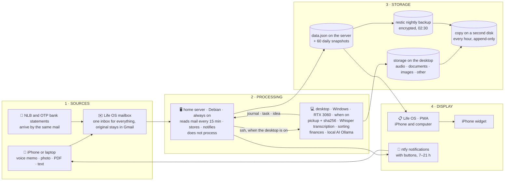

<p align="right">
  <a href="README.md"></a>
  <a href="README.sl.md"></a>
</p>

<div align="center">

# ⚡ Life OS

### The app that talks me into starting and shows me I'm making progress.

**Life OS is a personal system I built for myself: a web app for tasks, goals and a journal, a single e-mail inbox for voice memos and documents, and a local AI. It runs on an old laptop at home, no cloud.**


<sub>All screenshots show made-up demo data (<code>aplikacija/demo/demo-podatki.js</code>), not my real data.</sub>

</div>

---

## In short

- **What:** a web app (PWA) for tasks, goals, journal, health, finances and calendar, the same on iPhone and computer.
- **Input:** I send a voice memo, photo, PDF or text to one mailbox; the system stores, transcribes and sorts it, and asks me with buttons on the phone when unsure.
- **Where it runs:** a server made from an old laptop (Debian) only receives and forwards; the desktop processes (Whisper, Ollama) and stores.
- **Security:** invisible from the internet (Tailscale), SSH with keys only, encrypted nightly backups and an hourly copy to a second disk.
- **Status:** the path from voice memo to task works end to end (verified 7 and 8 Nov 2026); the published code is the 1 Nov state, the input code is coming.
- **Built with:** React 19 + TypeScript (PWA), dependency-free Python, systemd, ntfy, restic, Whisper, Ollama. Built in pair with an AI assistant; 80% of the decisions are mine.

---

> **How to read this.** This README is a story in six chapters: why the project exists, how a single voice memo travels through the system, what already works, what I'm building next, why I picked exactly these building blocks, and what I learned. If you want the chronicle by phases, with the dead ends and the hardware that gave up along the way, it is in **[ZGODBA.md](ZGODBA.md)** (in Slovenian).

1. [Why: eighteen systems and none in use](#1-why-eighteen-systems-and-none-in-use)
2. [The journey of one voice memo](#2-the-journey-of-one-voice-memo)
3. [What already works](#3-what-already-works)
4. [What I'm building next](#4-what-im-building-next)
5. [Why these choices](#5-why-these-choices)
6. [What I learned](#6-what-i-learned)

---

## 1. Why: eighteen systems and none in use

I know myself. When I have a deadline and a consequence, I deliver. When I don't, I build systems and then don't use them. At one point I had eighteen parallel productivity systems, notes in ten apps and two different "me"s: one on the phone and one on the computer, because each browser kept its own data. A journal with the instruction "write down how your day went" stayed empty for 46 days. **Life OS solves exactly that.** Everything that crosses my mind or lands in my inbox goes through a single entry point. It asks me for at most one line or one tap. Every Sunday it shows me whether I'm better than the week before. And all of it runs at home, on an old laptop that is invisible from the internet. The app doesn't measure whether I'm perfect. It measures whether I showed up.

| What stops me | What Life OS does |
|---|---|
| The bar to start is too high | **One line a day.** A journal I fill in within ten seconds. A voice memo I just say out loud. |
| Failure stops me | **"Success through failures."** Every failed attempt counts. A hundred attempts is a goal reached. |
| I don't know if I'm making progress | **Weekly review:** this week against the last one, plus a report written by a local AI. |
| I forget | **Reminders on my phone** at 16:00 (overdue tasks), at 19:00 (goals) and an hour before an event. Never after 21:00. |
| Everything is scattered | Tasks, goals, journal, health, finances, calendar, mail and voice memos **in one place**, on every device. |

---

## 2. The journey of one voice memo

Saturday, 8 November 2026, 10:14. I'm standing in the kitchen and say into my phone: **"V taske: moram kupiti mleko"** ("To tasks: I need to buy milk"). I share the memo to the Life OS mailbox and put the phone away. What happens in the next 45 minutes is the entire architecture of this project.

1. **10:20 · home server.** The mail reader, which runs every 15 minutes, sees a new mail. It saves the attachment, marks the mail as read and labels it "Processed". The original stays in Gmail. The server processes nothing. It only receives, stores and waits.
2. **10:30 · desktop PC.** The *pickup* job (every 15 minutes, whenever the PC is on) pulls the memo over SSH, checks its fingerprint (sha256) and files it in the storage, in the folder `zvok/2026-11/`. It never overwrites an existing file. Then it starts the transcription.
3. **10:31 · transcription.** Whisper (the large-v3-turbo model with my custom vocabulary) transcribes the memo on the GPU in a few seconds (in a test, 8 seconds of audio in 2.6 seconds). This time it hears *"V taz"* instead of *"V taske"*. The rule that works out from the first word where a note belongs doesn't know that one. The memo lands in "Unsorted".
4. **10:40 · notification.** The *waiting room* on the server notices the change and sends to my phone: **"Not sure where this goes"**, with the buttons *Task · Journal · Idea · Discard*. Notifications only arrive when something changes, and only between 7:00 and 21:00.
5. **10:59 · me.** I tap *Task*. The server writes the task, the app shows it on the iPhone and the computer, and the phone gets "Saved to tasks".
6. **11:40 · backup.** Every hour the whole LifeOS folder is copied to a second disk. The storage there is only ever added to, never overwritten, so a corrupted original can't destroy a good copy.

I fixed the rule for "V taz" the same day. The next memo goes through without a question. That is how the system grows: not with a new feature, but by fixing a rule every time I catch it making a mistake.

### The same flow in one diagram



### This graph started in a notebook


In November, working on "one inbox for all inputs", I fell into a trap: I handed everything to the AI assistant. In a single session it ran a test of four speech-to-text models and drew up two architecture plans, then merged them before I understood what was going on. I had a pile of files and no longer knew where we were.

I stopped, took a notebook and drew what should flow where: **the server only receives and forwards, the desktop processes and stores.** The sketch became [`graf/graf-za-ai.md`](graf/graf-za-ai.md) (in Slovenian), which is now the *single source of truth* for the data flow. Every node has a state: *confirmed* (I said so), *open* (not decided yet) or *working* (verified in practice). The AI follows the graph, not the other way round. It may only propose new nodes in the "Open questions" section. In one day the graph went through five versions, one confirmed step at a time. The human-readable version: [`graf/graf-za-ljudi.html`](graf/graf-za-ljudi.html) (in Slovenian).

<br clear="all">

### What runs where

All the code lives in one git repo. It runs in two places, though: on the server, which is always on, and on the desktop, which has the GPU and the big disk. Nothing runs on the phone. The phone only sends and looks.

| | Program | When | What it does |
|---|---|---|---|
| 🖥️ **server** | app (`streznik.py`) | always | API and app; one JSON with versions, daily snapshots kept for 60 days |
| | mail reader | every 15 min | saves mail and attachments, labels them "Processed", recognises bank statements and job interviews |
| | waiting room | every 15 min | counts what is waiting for the desktop and sends a notification only on change |
| | statements, subscriptions | after every mail run | PDF statements from NLB and OTP → transactions; subscriptions with a reminder the day before |
| | reminders | 16:00 · 19:00 · an hour before an event · Sun 19:30 | overdue tasks, goals, events, weekly report |
| | cleanup | 04:00 | after 7 days removes what is safely in the storage **and** on the second disk; for now it only prints |
| | nightly backup (restic) | 02:30 | encrypted backup of the server; the desktop pulls it over in the morning |
| 💻 **desktop** | pickup | every 15 min | pulls new files, checks sha256, sorts text by its first word |
| | transcription (Whisper) | on a new memo | memo → text → task / journal / idea / unsorted |
| | copy to second disk | every hour | append-only storage, every original verified |
| | local AI (Ollama) | every minute | answers questions from the app, daily summary after 20:00, weekly report |
| | finances | 17:00 | statements and IBKR → spreadsheet → summary into the app |

### The most interesting bit of code: sync without a database

Every change in the app is a **function** (`data → new data`) that goes into a queue. When I send it to the server, I tell it which version I last saw. If another device saved in the meantime, the server returns `409` and its own version. The app then **replays my changes on top of the new data**. The phone and the computer never overwrite each other, with no database and no libraries. → [`aplikacija/src/store/useStore.ts`](aplikacija/src/store/useStore.ts), [`streznik/streznik.py`](streznik/streznik.py)

---

## 3. What already works

Everything below runs on my server and I use it every day. The first page is "Today": how much of the day is gone, three priorities, goals with attempts, sleep, mood and a one-line journal.

<table>
<tr>
<td width="50%"><br><b>Goals and attempts.</b> Every failed attempt is a step forward. A hundred attempts is a goal reached.</td>
<td width="50%"><br><b>Weekly review.</b> This week against the last one, and a report with a single focus for the week ahead. In the screenshot from 1 Nov it is still written by Claude; since 4 Nov a local model on my own PC writes it.</td>
</tr>
<tr>
<td><br><b>Tasks</b> with priority and due date. Overdue ones reach my phone at 16:00.</td>
<td><br><b>Journal.</b> One line a day plus mood. Ten seconds.</td>
</tr>
<tr>
<td><br><b>Sleep.</b> Hours, quality, trend.</td>
<td><br><b>Health.</b> Weight, water, steps, mood and energy.</td>
</tr>
<tr>
<td><br><b>Workouts.</b> Sessions, exercises, calories.</td>
<td align="center"><br><b>On the phone.</b> Installable app (PWA), the same data as on the computer.</td>
</tr>
</table>

**Verified end to end** (the date says when I actually saw it work):

| When | What |
|---|---|
| 31 Oct | restore from the server's nightly backup; a backup you haven't restored isn't a backup |
| 4 Nov | the iPhone always gets the new version of the app; mail reader; NLB and OTP statements from mail → transactions → Finance page; Network page (cable, router, internet) |
| 7 Nov 20:44–20:51 | a voice memo, a photo and a PDF in one mail → storage (sha256 matches) → notification "Saved to the desktop: 1 document, 1 image, 1 recording" → copy to the second disk (10/10 verified) |
| 8 Nov | voice memo → transcription → decision with a button → task (the story from chapter 2) |
| every day | copy to the second disk every hour, every original verified; notifications only between 7:00 and 21:00 |

**Not yet in the screenshots** (added in November, the code lands in the repo in the next step): Finance (statements, subscriptions, overview by year, monthly plan), Calendar (including a subscribed Apple calendar), Clients, Work (job interviews from the work mailbox, into the calendar with one click), Stocks, Ask AI (local model, 👍/👎 rating under every answer), Network.

**Not yet verified** (built, waiting for the first automatic run or for my decision):
- the local AI's Sunday weekly report: the first automatic Sunday run is not confirmed yet,
- the monthly portfolio report (first one on 1 Dec) and the weekly sector analysis,
- server cleanup after 7 days: runs in dry mode, I switch it on for real myself,
- transcription: verified end to end once, the vocabulary grows with use.

---

## 4. What I'm building next

I set the order, one step at a time. Every step gets one line in `PROGRESS.md`, every decision one line in `DECISIONS.md`.

| What | State | Condition |
|---|---|---|
| **Switch on server cleanup** after 7 days, only for files that are in the storage and on the second disk | installed, dry mode | once the output has shown the right thing for a few days (around 14 Nov) |
| **Publish the input code to this repo**: mail reader, waiting room, pickup, transcription, the new `streznik.py` | running live; the repo has the state from 1 Nov | once I have scrubbed it of secrets |
| **What processing stays on the server** (statements, subscriptions and reminders predate the graph) | open question in the graph | my decision |
| **Docker for Life OS**, so nobody deletes it by accident | open | |
| **Apple Health → sleep and steps** via a Shortcut on the iPhone | open | |
| **Tests for the sync** (409 and replaying changes) | open | |
| **Weekly review of the 👎 ratings** given to the local AI, so its instructions improve | manual | |
| **Server battery** reads 0%; on a power cut the server shuts down | open | diagnostics or a new battery |

---

## 5. Why these choices

Every choice has a price. Here is what I got and what I pay.

| Decision | Why | What it costs me |
|---|---|---|
| **An old laptop as the server** (HP, dual-core i7, 7.7 GB RAM, Debian 13) | free, quiet, always on; I'm learning Linux on real hardware | weak, so processing happens on the desktop; the battery doesn't hold |
| **Tailscale instead of open ports** | the server is invisible from the internet; SSH by key only; Lynis score 62 → 75 | no access without Tailscale on the device; my own mail server would need open ports, hence a separate Gmail mailbox |
| **Python without libraries, one JSON instead of a database** | one user, little data; no dependencies that go stale | everything in memory; I resolve conflicts myself (409 and replay) |
| **React 19, TypeScript, Vite, Tailwind as a PWA** | one codebase for phone and computer; install without the App Store; my own service worker | offline, only what was already open keeps working |
| **Mail as the inbox** | the iPhone already has it (Share → Mail); the original stays in Gmail; no upload app of my own | up to 15 minutes of delay; the app only reads mail, never sends |
| **The server only receives and forwards, the desktop processes** | the GPU and the disk are on the desktop; the server stays simple | when the desktop is off, things wait; hence the "waiting" notification |
| **Whisper locally** (large-v3-turbo with a custom vocabulary, RTX 3060) | privacy; no paid APIs; Slovenian with my own words | 1.5 GB model; "V taske" isn't "V taz", the vocabulary grows by hand |
| **Local AI** (Ollama, qwen3.5:9b) | data stays at home; Python computes the facts, the model only puts them into words | weaker than cloud models; hence only summaries and questions about my data |
| **ntfy in Docker** | notifications with buttons without an Apple developer account; the same channel for SSH logins and new devices on the network | one more service to maintain |
| **restic at night plus an hourly copy to a second disk** | encrypted; restore tested; the storage is append-only | two backup mechanisms |
| **Git for code only, data outside** | I can publish the repo; personal data is protected by the backup, not by git | no data history in git |
| **AI writes the programs, it doesn't run the pipeline** | same input → same output; I understand every step; the AI loops in a long chain | slower than "let the AI do everything" |

---

## 6. What I learned

- **Designing end to end**: source → processing → storage → display → backup → notification. On paper first, in code second.
- **Data without loss**: versions, conflicts, fingerprints, daily snapshots and a restore I actually tested.
- **Security by default**: no open ports, SSH by key only, secrets never in the code.
- **A product for the user**, even when the user is me: a feature I don't use has no value. Hence the low bar and the reminder at the right moment.
- **Knowing when to stop**: a wall tablet from 2012 was a great exercise in diagnosis (a corrupted system XML, failing NAND memory), but the goal was the planner, not the tablet. The code stayed in [`tablica/`](tablica).
- **Working with AI without losing control**: 80% of the thinking and the decisions are mine, 20% is the AI. First it lists the steps for me, then we do only the current one. Nothing moves on without my "yes". Every project has three files, `CLAUDE.md` (the map), `PROGRESS.md` (the state) and `DECISIONS.md` (the decisions), so the human and the AI always know where we are.

I'm building this project in a pair with **Claude Code**. I set the goals, decide, test on my phone and draw the graphs. The AI writes the code following my steps, reads the logs and writes the notes. It is a way of working I want to bring to a team as well.

---

## Repository

Folder and file names are in Slovenian; the table translates them.

| Folder | What it is | State |
|---|---|---|
| [`aplikacija/`](aplikacija) (app) | the web app (React 19, TypeScript, Vite, Tailwind, Recharts, PWA); Slovenian and English UI | state from 1 Nov: overview, tasks, goals, workouts, journal, week, sleep, health, projects |
| [`streznik/`](streznik) (server) | `streznik.py` (API, versions, 409), reminders, weekly report, systemd units | state from 1 Nov; the mail reader, the waiting room and the mail inputs are coming |
| [`infrastruktura/`](infrastruktura) (infrastructure) | nftables, SSH, fail2ban, unattended upgrades, ntfy, restic, alerts on login and on a new device | current |
| [`graf/`](graf) (graph) | the data flow: `graf-za-ai.md` (source of truth, version 5), `graf-za-ljudi.html`, the notebook sketch; in Slovenian | current |
| [`tablica/`](tablica) (tablet) | Android kiosk (Java, no Gradle) and a Python planner that draws straight to the screen | finished; tablet scrapped on 31 Oct |
| [`slike/`](slike) (screenshots) | screenshots with demo data | 1 Nov |
| [`ZGODBA.md`](ZGODBA.md) (the story) | chronicle by phases: plan, server, app, habits, tablet, the AI trap; in Slovenian | |

### Running it

```bash
cd aplikacija
npm install
npm run dev
```

The app also works without the server (the data stays in the browser). For demo data, open the browser console, paste the contents of [`aplikacija/demo/demo-podatki.js`](aplikacija/demo/demo-podatki.js) and reload the page.

Server: `python3 streznik/streznik.py`, then `LIFEOS_API=http://127.0.0.1:8090 npm run dev`.

### What is deliberately not in the repository

Passwords, keys (SSH, the Android signing key), the address of my Tailscale network, the notification topic name, the mailbox address, home IPs, my data, recordings and transcripts. Where the code needs them, they are replaced with placeholders (`TVOJ-TAILNET`, `$KS_GESLO`, `$NTFY_TEMA`).

---

<div align="center">

**David Planinšek** · junior data engineer → analytics engineering

</div>
