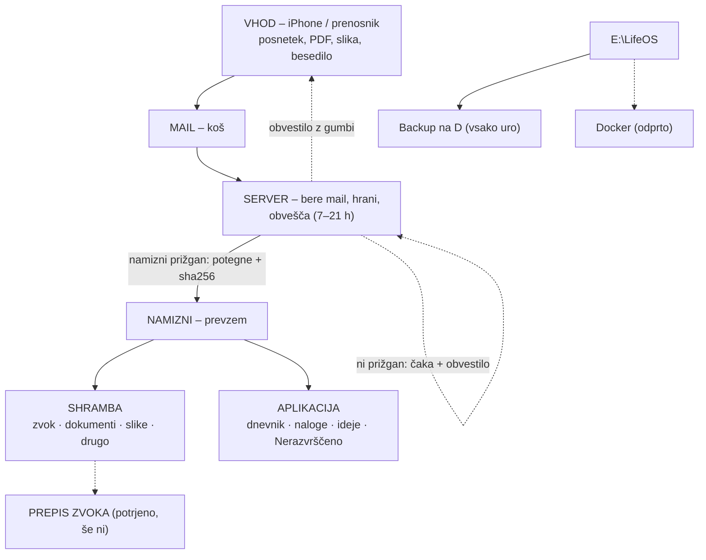

# LifeOS – tok podatkov (graf za AI)
Vir: Davidova skica, 2026-11-07 (`skica-2026-11-07.jpg`). Prepis potrdil David 2026-11-07.
Verzija: 5. Ob vsaki spremembi povečaj verzijo in dopiši vrstico v »Zgodovina«.

## Pravila za AI
- To je EDINI vir za tok podatkov LifeOS. Graf za ljudi (`graf-za-ljudi.html`) mora vedno ustrezati tej datoteki.
- Ne dodajaj vozlišč ali povezav, ki jih David ni potrdil. Predloge piši v »Odprta vprašanja«.
- Stanje vsakega vozlišča: `potrjeno` (David rekel) | `odprto` (še ni odločeno) | `deluje` (preverjeno v praksi).
- Graf se posodablja sproti, ko David kaj potrdi ali ko se kaj preveri v praksi (David, 7. 11.).

## Vozlišča
```yaml
nodes:
  - id: vhod
    naprava: iPhone / prenosnik
    vloga: posnetek, PDF, slika ali besedilo pošlje na mail
    pravilo: pri mailu z besedilom prva beseda v zadevi pove, kam gre (dnevnik | naloga | ideja | razgovor)
    stanje: deluje          # preizkus 7. 11. 20:44: posnetek + slika + PDF
  - id: mail
    naprava: e-poštni predal Life OS
    vloga: vhodni koš (»za enkrat«); original ostane v Gmailu
    stanje: deluje
  - id: server
    naprava: strežnik »doma« (Debian)
    vloga: prebere mail vsakih 15 min (označi prebrano + Obdelano), hrani, dokler namizni ne prevzame, obvešča
    pravila:
      - samo prejme, hrani in prepošlje, NE obdeluje (izjema od prej: izpiski, naročnine, opomniki – odprto)
      - če namizni ni prižgan: hrani pri sebi; namizni pobere, ko se prižge
      - obvestila samo ob spremembi in samo 7–21 h: shranjeno | čaka (≥30 min, namizni ugasnjen) | zamuja | zapisano | ne vem, kam spada (gumbi) | prazen mail
      - briše po 7 dneh (David 7. 11.): samo priponke + .eml, ko so v shrambi IN preverjene na D:; ohrani meta.json, maile brez priponke, izpiske, razgovore. Zaenkrat SUHO (samo izpiše) – zares vklopi David
    programi: lifeos-mail, lifeos-cakalnica, aplikacija (streznik.py: /api/vnos, /api/razvrsti)
    stanje: deluje
  - id: namizni
    naprava: namizni računalnik (Windows)
    vloga: vsakih 15 min pobere s strežnika (ssh, samo branje), preveri sha256, vloži v shrambo; mail z besedilom razvrsti po prvi besedi
    programi: E:\LifeOS\prevzem\prevzem.py (opravilo »LifeOS prevzem«)
    stanje: deluje
  - id: shramba
    pot: E:\LifeOS\shramba\{zvok,dokumenti,slike,drugo}\RRRR-MM\
    vloga: trajni dom originalov; nova kategorija = vrstica v vrste.json
    stanje: deluje
  - id: aplikacija
    naprava: Life OS (strežnik, iPhone)
    vloga: dnevnik, naloge, ideje iz maila; kartica »Nerazvrščeno« za odločitev
    stanje: deluje          # kartica preverjena na testni kopiji 7. 11.; pravi mail z besedilom še ni preizkušen
  - id: backup_d
    naprava: namizni, disk D
    vloga: kopija E:\LifeOS → D:\Varnostne-kopije\LifeOS (vsako uro), zraven kopija strežnika v ...\doma
    pravilo: shramba se na D: samo dopolnjuje, nikoli prepiše; nič se ne briše
    stanje: deluje
  - id: lifeos_mapa
    pot: E:\LifeOS (git za kodo; osebni podatki niso v gitu)
    vsebina: [aplikacija, prevzem, shramba, finance, varnostna-kopija, graf]
    opomba: E:\Projekti ostane samo za seznam ali stranske projekte; E:\Projekti\PErsonal_app je zamrznjen
    stanje: deluje
  - id: prepis_zvoka
    naprava: namizni (grafična kartica)
    vloga: posnetek → besedilo (Whisper turbo + slovar), nato prva beseda (»V taske …«) → naloga/dnevnik/ideja
    program: E:\LifeOS\prepis\prepis.py (zažene ga prevzem)
    stanje: deluje          # nameščeno 7. 11.; preizkus na grafični: 8 s posnetka v 2,6 s; od konca do konca še ni preizkušeno
  - id: docker
    vloga: LifeOS teče v Dockerju, da ga nihče ne pobriše
    stanje: odprto   # »bi bilo fino«
```

## Povezave
```yaml
edges:
  - {od: vhod,      do: mail,        kaj: posnetek / PDF / slika / besedilo}
  - {od: mail,      do: server,      kaj: server bere mail vsakih 15 min}
  - {od: server,    do: namizni,     kaj: namizni potegne (ssh, sha256), pogoj: namizni prižgan, sicer čaka na serverju}
  - {od: namizni,   do: shramba,     kaj: original po vrstah}
  - {od: namizni,   do: aplikacija,  kaj: besedilo maila (dnevnik / naloga / ideja) ali »ne vem, kam spada«}
  - {od: server,    do: vhod,        kaj: obvestilo na telefon (7–21 h), gumbi za odločitev}
  - {od: shramba,   do: prepis_zvoka, kaj: posnetek, stanje: potrjeno}
  - {od: lifeos_mapa, do: backup_d,  kaj: varnostna kopija vsako uro}
  - {od: lifeos_mapa, do: docker,    kaj: zaščita, stanje: odprto}
```

## Diagram (Mermaid)


## Odgovori na vprašanja iz v1
1. **Kje teče koda:** shranjena v gitu `E:\LifeOS`. Teče na strežniku (bralec maila, čakalnica, aplikacija) in na namiznem (prevzem, kopija na D:, finance, lokalni AI). Na prenosniku in iPhonu nič. (David 7. 11.)
3. **Način prenosa:** namizni sam potegne s strežnika prek ssh vsakih 15 min in ob prijavi; strežnik ne odpira poti do namiznega. (deluje 7. 11.)

## Odprta vprašanja
2. Docker za LifeOS – da ali ne, in kaj točno mora zaščititi?
4. Brisanje na strežniku: program `lifeos-pocisti` je nameščen v SUHEM načinu (vsak dan 04:00 samo izpiše). Zares ga vklopi David, ko vidi, da izpis kaže pravo. Opomba: nočna kopija strežnika hrani izbrisano le ~5 tednov – potem sta kopiji shramba (E: + D:) in Gmail.
5. Strežnik že obdeluje izpiske, naročnine in opomnike (pred grafom). Ostane tako ali gre na namizni?

## Zgodovina
- v1 2026-11-07: prvi graf po skici.
- v2 2026-11-07 22:00: zgrajeno in preverjeno – shramba po vrstah, prevzem, čakalnica z obvestili, mail z besedilom (prva beseda, gumbi, kartica), kopija na D:. Odgovori na vprašanji 1 in 3. Dodani vozlišči shramba, aplikacija, prepis_zvoka (potrjeno).
- v3 2026-11-07 22:15: brisanje po 7 dneh nameščeno v suhem načinu (varovalka: preverjeno na D:).
- v4 2026-11-07 22:25: prepis zvoka pripravljen (E:\LifeOS\prepis), čaka namestitev.
- v5 2026-11-07 22:45: prepis zvoka nameščen in preizkušen na grafični kartici.
